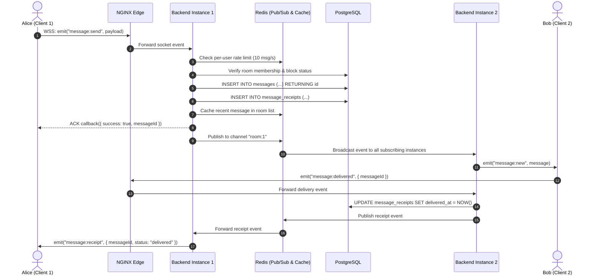

# Aether System Architecture

## 1. System Overview

Aether is a real-time communication platform engineered for high-throughput, low-latency messaging, horizontal scalability, and calm user experience. The core architecture isolates stateful WebSocket connections from stateless application logic using a distributed pub/sub bus (Redis), a relational transactional datastore (PostgreSQL), and a reverse proxy/load balancer (NGINX).

```mermaid
flowchart TD
    Client1["Web Client 1<br/>(Socket.IO / React)"]
    Client2["Web Client 2<br/>(Socket.IO / React)"]
    ClientN["Web Client N<br/>(Socket.IO / React)"]

    subgraph Edge["Edge Layer"]
        Nginx["NGINX Reverse Proxy / LB<br/>(SSL Termination, HTTP/WS Routing)"]
    end

    subgraph Cluster["Application Cluster"]
        Backend1["Aether Backend 1<br/>(Node.js / Express / Socket.IO)"]
        Backend2["Aether Backend 2<br/>(Node.js / Express / Socket.IO)"]
    end

    subgraph MessagingBus["Distributed State & Pub/Sub"]
        Redis["Redis 7 Cluster<br/>(Socket.IO Redis Adapter, Caching, Rate Limiting)"]
    end

    subgraph Persistence["Storage & Search Layer"]
        Postgres[("PostgreSQL 15<br/>(Transactional Data, Rooms, Messages)")]
        ES[("Elasticsearch 8<br/>(Full-Text Message Search - Non-E2E)")]
        Uploads[("Persistent Storage<br/>(Media & File Uploads)")]
    end

    Client1 -->|TLS / WSS| Nginx
    Client2 -->|TLS / WSS| Nginx
    ClientN -->|TLS / WSS| Nginx

    Nginx -->|Proxy Pass (ip_hash)| Backend1
    Nginx -->|Proxy Pass (ip_hash)| Backend2

    Backend1 <-->|Pub/Sub Adapter| Redis
    Backend2 <-->|Pub/Sub Adapter| Redis

    Backend1 --> Postgres
    Backend2 --> Postgres

    Backend1 -.->|Async Indexing| ES
    Backend2 -.->|Async Indexing| ES

    Backend1 --> Uploads
    Backend2 --> Uploads
```

---

## 2. Real-Time Message Flow & Delivery Lifecycle

When a user transmits a message, the lifecycle spans verification, database persistence, distributed fan-out, and delivery receipts:



---

## 3. Scaling & High Availability

### 3.1 NGINX Load Balancing & Sticky Sessions
- **Sticky Sessions (`ip_hash`)**: Essential when Socket.IO clients use HTTP long-polling as a fallback before upgrading to WebSockets. Ensures all handshake stages hit the same backend node.
- **WebSocket Native Connections**: Once a pure WebSocket connection is established, the persistent TCP socket remains pinned to the handling container, regardless of upstream balancing algorithm.
- **Connection Capacity Ceilings**: NGINX `events` block is tuned with `worker_connections 20000;` and `worker_rlimit_nofile 65535;` to avoid file descriptor starvation during high concurrency.

### 3.2 Multi-Node Redis Adapter
- Real-time rooms in Socket.IO are decoupled from individual Node.js processes using `@socket.io/redis-adapter`.
- When an event is emitted to `room:X`, the sending process publishes it to Redis. Every backend instance subscribed to that channel receives the message and immediately delivers it to any locally connected room members.

### 3.3 Kubernetes Horizontal Pod Autoscaler (HPA)
- The production Kubernetes deployment (`k8s/deployment.yaml`) configures an HPA targeting 70% CPU and 80% Memory utilization.
- Pod replicas automatically scale between 3 and 10 pods to accommodate traffic surges.

---

## 4. Data Layer Architecture

### 4.1 PostgreSQL Schema Design
- **Users & Sessions**: `users` (credentials, display names, 2FA settings), `user_sessions` (active socket tracking per node), `user_blocks`, `user_mutes`.
- **Rooms & Memberships**: `rooms` (direct, group, space), `room_members` (roles, aliases, chat lock states).
- **Messages & Receipts**: `messages` (UUID primary key, foreign keys to sender and room, E2E metadata flags, deletion tombstones), `message_receipts` (per-recipient delivery and read timestamps), `message_reactions`, `message_hidden_for`.
- **Media & Extensions**: `poll_votes`, `call_logs`, `contacts`, `friend_requests`, `constellations`, `user_keys` (E2E X3DH prekeys and identity keys).

### 4.2 Caching & Ephemeral State in Redis
- **Session Tokens**: Active refresh tokens with TTL.
- **Rate Limit Windows**: Sliding window token counters.
- **Presence & Heartbeats**: Online status keys (`presence:user:<id>`) with short expiration renewed via client heartbeats.
- **Typing Indicators**: Ephemeral sets (`typing:room:<id>`) cleared automatically on message transmission or timeout.

### 4.3 Search Isolation (Elasticsearch)
- Message text is indexed into Elasticsearch asynchronously.
- **Fault-Tolerant Isolation**: Elasticsearch indexing failures are caught and logged as warnings; they never block database persistence or message delivery.
- **E2E Privacy Boundary**: Messages flagged with `e2e: true` are strictly excluded from search indexing to prevent plaintext leakage of encrypted communication.
