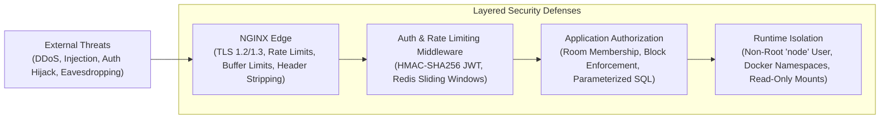

# Aether Security Architecture & Posture

## 1. Threat Model & Perimeter Overview

Aether operates as a multi-tenant, real-time messaging application with persistent WebSocket connections, REST APIs, and file uploads.

---

## 2. Authentication & Session Management

### 2.1 JWT Verification & Handshake Security
- Authentication is enforced prior to WebSocket handshake acceptance (`io.use(authenticateToken)`). Sockets lacking a valid bearer token are rejected immediately.
- JWT tokens are signed using HMAC-SHA256 with an operator-supplied secret of at least 256 bits (`openssl rand -hex 32`).
- Hardcoded fallback secrets in production configuration are strictly prohibited. Missing `JWT_SECRET` causes startup failure in both Compose and Kubernetes.

### 2.2 Password Security
- Passwords are encrypted using `bcrypt` with a cost factor of 10.
- Password hashes are stored in PostgreSQL and never exposed in API responses or log events.

### 2.3 Session Revocation
- Active sessions and refresh tokens are tracked in Redis. Operators can revoke user sessions globally by invalidating user tokens in Redis.

---

## 3. API & WebSocket Authorization

### 3.1 Strict Room Membership Enforcement
- All message dispatching (`message:send`), room modifications, and WebRTC calls verify that the requesting `userId` is an active member of `room_members` (`isUserMemberOfRoom(userId, roomId)`).
- Direct Messages (1-on-1) verify blocklists before message acceptance: if either party has blocked the other, message transmission is blocked with `Cannot send message to this user`.

### 3.2 Granular Rate Limiting
Aether implements Redis-backed sliding window rate limiters:

| Endpoint / Operation | Rate Limit | Purpose |
|---|---|---|
| `/api/auth/login`, `/api/auth/register` | 5 req / 15 min | Brute-force & credential stuffing defense |
| Socket.IO `message:send` | 10 msgs / sec / user | Spam & buffer exhaustion defense |
| `/api/upload` | 20 uploads / 15 min | Storage denial-of-service defense |
| `/api/search` | 30 req / min | Expensive search query protection |
| General HTTP endpoints | 100 req / min | Baseline API protection |

### 3.3 Injection & Input Validation
- **SQL Injection**: 100% of database interactions use parameterized queries (`Database.query('... $1, $2', [val1, val2])`). No string concatenation is used in query building.
- **Message Content**: Messages are capped at 10,000 characters; whitespace-only messages are rejected.
- **File Uploads**: Restrictive Multer middleware validates MIME types and extensions. Files are stored on a dedicated volume mounted to `/app/uploads`. Execution within upload directories is disabled.

---

## 4. Supply Chain & Secret Management

### 4.1 Automated Secret Detection (Gitleaks)
- Gitleaks runs in automated CI on every push and pull request.
- Known historical exposures in the Git history prior to PR #2 are documented in `.gitleaksignore` and `docs/GIT_HISTORY_PURGE_PROCEDURE.md`. Any new secret introduced will immediately fail CI.

### 4.2 Software Bill of Materials (SBOM)
- CycloneDX SBOMs (`root-sbom.cdx.json`, `backend-sbom.cdx.json`, `frontend-sbom.cdx.json`) are automatically generated in CI and retained as artifacts for 90 days.
- Npm peer dependency conflicts are actively audited; zero peer conflicts exist in the validated lockfiles.

### 4.3 Container Privileges
- Production Docker images for the backend run under unprivileged user `USER node` (UID 1000).
- Build tools (`make`, `g++`, `python3`) and `devDependencies` are purged during multi-stage builds before the runtime image is finalized.
